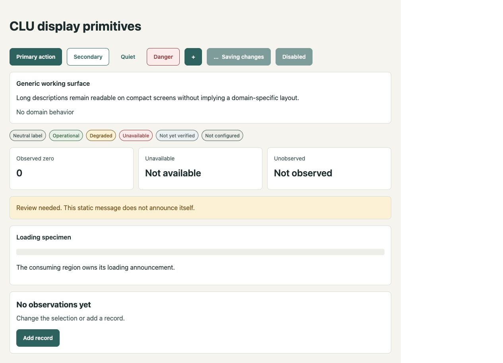
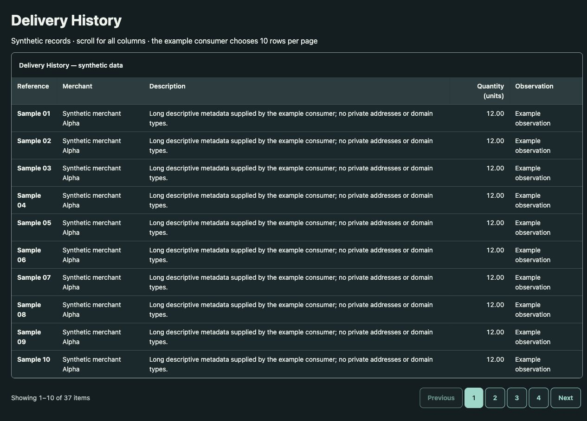
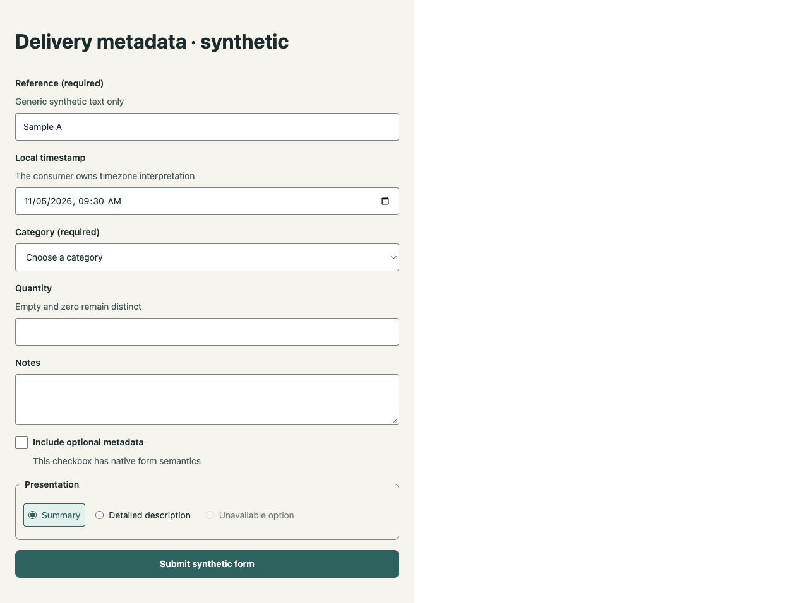
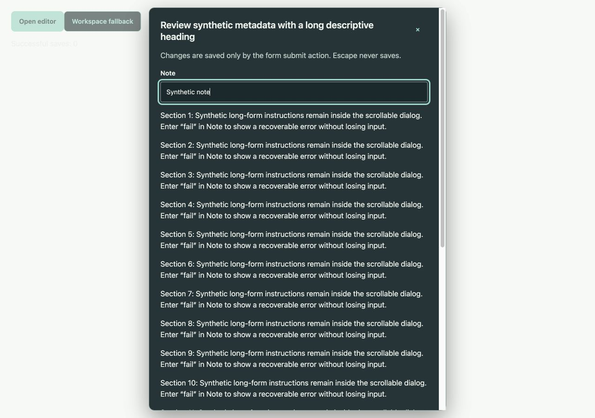
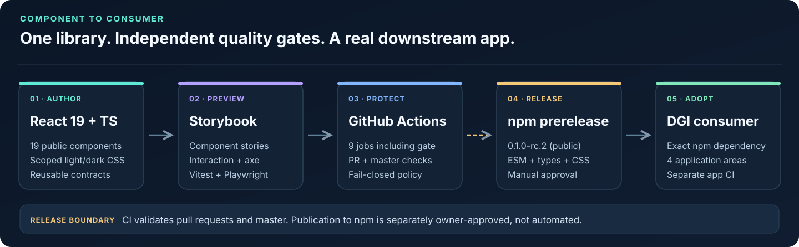
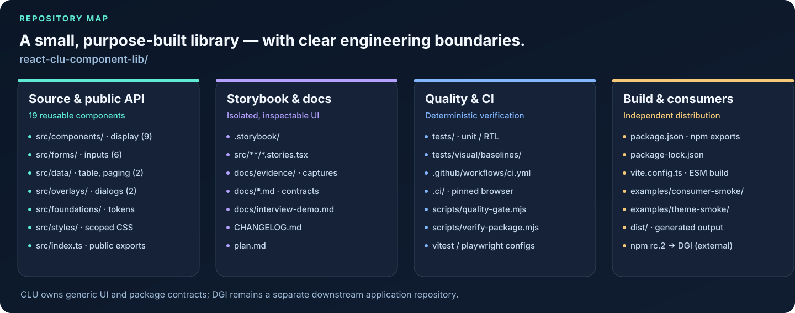

# CLU UI

**Reusable React components. Tested like a product. Published as a package.**

[](https://github.com/Shaobangzhu/react-clu-component-lib/actions/workflows/ci.yml)
[](https://www.npmjs.com/package/@shaobangzhu/clu-ui)
[](LICENSE)

CLU UI is an **open-source React 19 + TypeScript component library** for data-dense dashboards and operational interfaces. It delivers **19 reusable components**, scoped light/dark design tokens, accessible interaction patterns, and a separately consumable npm package.

**What makes this more than a UI exercise?** CLU has an independent build and test pipeline, browser-tested Storybook examples, an audited package boundary, a public npm prerelease, and an actual consumer: [Delivery Geo Intelligence (DGI)](https://github.com/Shaobangzhu/delivery-geo-intelligence).

[**Explore screenshots**](#component-showcase) · [**See the engineering workflow**](#engineering-workflow) · [**Inspect CI**](https://github.com/Shaobangzhu/react-clu-component-lib/actions/workflows/ci.yml) · [**View npm package**](https://www.npmjs.com/package/@shaobangzhu/clu-ui/v/0.1.0-rc.2) · [**See adoption evidence**](docs/consumer-integration.md)

## At a glance

| Library | Quality evidence | Distribution |
| --- | --- | --- |
| **19 components** across display, forms, data and overlays | **83 unit tests**, **166 Storybook browser/a11y tests**, **12 reviewed visual baselines** | **`@shaobangzhu/clu-ui@0.1.0-rc.2`** on npm; adopted by a separate React application |
| React 19, strict TypeScript, scoped light/dark CSS | **9 GitHub Actions jobs**, with an aggregate Quality gate | ESM + declarations + opt-in compiled CSS; React remains a peer dependency |

*Quality counts are from the documented P11 verification snapshot (November 2026), not a claim that tests were rerun for this README edit. [Verification details](docs/release-readiness.md).*

## Component showcase

Real Chromium captures from the repository's **Storybook component reviews**, using synthetic demonstration data. The gallery includes light/dark themes, responsive layouts and interactive states; these screenshots are review evidence, not visual-regression goldens.

| Display primitives · light | Data table · dark |
| :---: | :---: |
|  |  |
| **Forms · light** | **Dialog · dark** |
|  |  |

[Light/dark token gallery](docs/p02-verification.md) · [Responsive mobile reviews](docs/p05-verification.md) · [Accessibility and visual-testing approach](docs/ci-quality.md)

**Interactive Storybook:** Run `npm ci && npm run storybook` with Node 22.23.4 / npm 10.9.0, then open `http://localhost:6006`. A publicly hosted Storybook is **not yet available**; screenshots are provided so reviewers can inspect the project without a local setup.

## Engineering workflow



- **Build once:** React 19 + TypeScript source is packaged as ESM, declaration files and namespaced CSS. Consumers do not need Tailwind installed.
- **Validate independently:** Vitest / React Testing Library, Storybook interactions and axe checks, Playwright Chromium/keyboard/visual tests, and an external `npm pack` consumer check.
- **Protect changes:** GitHub Actions runs on pull requests and `master` pushes; the **Quality gate** rejects failed, skipped or missing mandatory stages.
- **Publish deliberately:** npm publication is an **owner-authorized manual step**, not an automatic GitHub Actions deployment. The tagged [v0.1.0-rc.2 GitHub prerelease](https://github.com/Shaobangzhu/react-clu-component-lib/releases/tag/v0.1.0-rc.2) records source history; npm is the compiled distribution channel.

[Architecture details](docs/architecture.md) · [CI and quality operations](docs/ci-quality.md) · [Package/release verification](docs/npm-github-sync.md)

## Repository map



This is a standalone library repository, **not a monorepo with its consumer**. CLU owns reusable presentation and interaction contracts; DGI owns its GIS, API, delivery data and business rules. See [component contracts](docs/display-primitives.md) and [architecture boundaries](docs/architecture.md).

## Quality engineering

| Layer | Verified approach |
| --- | --- |
| Static checks | ESLint (warnings fail), strict TypeScript across source, stories and tests |
| Unit & interaction | **83 Vitest/RTL tests**; **93.57% statement coverage** in the P11 snapshot |
| Storybook / accessibility | **166 browser story tests** with blocking automated axe checks |
| Visual & keyboard | **6 Playwright tests** and **12 desktop/mobile light/dark zero-diff baselines** on pinned Linux Chromium |
| Package integrity | External packed consumer checks ESM, Bundler/NodeNext types, Vite production build, SSR, exports and one shared React |
| CI gate | **6 parallel check jobs + component browser job + visual job + aggregate Quality gate** |

All counts refer to the [recorded verification run](docs/release-readiness.md). Automated accessibility checks are **not** a WCAG certification or a substitute for full manual assistive-technology review. For this portfolio prerelease, **production dependency vulnerabilities rated moderate+ block CI**; development-tool findings are disclosed as non-blocking warnings. Known risks and the exact policy are documented in [CI quality](docs/ci-quality.md).

## Install and use

The public package is a **prerelease**, not stable v1. Install the exact version for reproducible consumption:

```bash
npm install --save-exact @shaobangzhu/clu-ui@0.1.0-rc.2
```

```tsx
import { Badge, Button, Card } from '@shaobangzhu/clu-ui';
import '@shaobangzhu/clu-ui/styles.css';

export function Example() {
  return (
    <section data-clu-theme="light">
      <Card>
        <Badge>Ready</Badge>
        <Button>Continue</Button>
      </Card>
    </section>
  );
}
```

React `^19.0.0` is required as a peer dependency; browser apps provide ReactDOM. Import the CSS once and place components under `data-clu-theme="light"` or `"dark"`. See the [package contract](docs/package-contract.md).

## Verified real-world adoption

[**DGI**](https://github.com/Shaobangzhu/delivery-geo-intelligence) consumes the **published npm rc.2 artifact** through an exact dependency and lockfile, rather than importing CLU's source. Its **Dashboard, Settings, History and Merchants** integrations were reviewed and merged with separate application quality gates. CLU remains domain-agnostic; consumer-specific dates, pagination policies, providers and business rules stay inside DGI.

[**Read the consumer integration evidence**](docs/consumer-integration.md) · [**Open the npm release**](https://www.npmjs.com/package/@shaobangzhu/clu-ui/v/0.1.0-rc.2)

## Explore the documentation

| Want to inspect… | Start here |
| --- | --- |
| Architecture and source/consumer boundaries | [Architecture](docs/architecture.md) |
| Component APIs and design tokens | [Display](docs/display-primitives.md) · [Forms](docs/form-controls.md) · [Data](docs/data-presentation.md) · [Overlays](docs/overlays.md) · [Tokens](docs/design-tokens.md) |
| Tests, quality gates and CI operations | [CI quality](docs/ci-quality.md) |
| Package contract and verified publication | [Package contract](docs/package-contract.md) · [npm/GitHub audit](docs/npm-github-sync.md) |
| Release decisions and limitations | [Release readiness](docs/release-readiness.md) · [Changelog](CHANGELOG.md) |
| Fast technical interview walkthrough | [One-minute demo](docs/interview-demo.md) |

**Maintainer:** [Chaoran Lu](https://github.com/Shaobangzhu) · **License:** [MIT](LICENSE) · **Current status:** Public `0.1.0-rc.2` prerelease; stable v1 not released.
