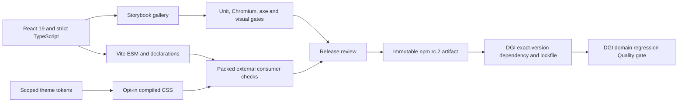

# CLU architecture

CLU is the generic UI repository; DGI is a separate application repository. CLU owns rendering semantics, native interactions and namespaced design tokens. DGI owns data, dates/DST, formatting, pagination policy, provider state, GIS/AI and business validation.

The diagram describes the delivery contract, not an automated npm publishing workflow. Publishing remains separately authorized. The [verified DGI snapshot](consumer-integration.md) consumes npm, not CLU source, workspace aliases or GitHub source archives.

## Package boundary

`src/index.ts` intentionally exports 19 runtime APIs and 27 types (inventory: `scripts/public-api.json`). Vite externalizes React/ReactDOM and JSX runtimes. React ^19 is the sole runtime peer; ReactDOM is supplied by browser applications. Separate declaration generation emits the public reachable graph, with ESM .js specifiers and no source maps. The archive allowlist is 25 files: package metadata, README, MIT LICENSE, index.js, styles.css and 20 declarations.

Tailwind v4 is a build-time authoring tool only. Consumers import `@shaobangzhu/clu-ui/styles.css` once, then use explicit light/dark `data-clu-theme` hosts. No Preflight, global reset, consumer Tailwind scanner or web-font dependency is required. Public tokens are documented in [design tokens](design-tokens.md); internal class names are implementation details.

## Development and evidence

Use Node 22.23.4 / npm 10.9.0 and `npm ci`. `npm run storybook` opens the local gallery at [localhost:6006](http://localhost:6006): Foundations, Display, Forms, Data, Overlays and deterministic Quality fixtures. Static output is produced by `npm run build-storybook`; there is no verified public Storybook URL. The internal scaffold is not a public component.

`quality:check` covers lint/types, unit coverage, library/Storybook builds and external package consumption. `quality:all` additionally runs pinned Linux Chromium Storybook/axe/visual checks, dependency security and failure-propagation probes. The [CI contract](ci-quality.md) lists nine jobs including aggregate Quality gate. DGI's tests remain a separate evidence set; never add its counts to CLU's.

The [readiness record](release-readiness.md) distinguishes current source, immutable npm bytes, Git tag/Release, successful checks, deployment failures and remaining owner decisions.
